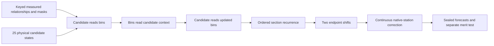

# Two-way attention on source-addressed well observations

This first-party experiment tests the user's proposed meta → discrete → meta adaptation. Physical candidate states read measured relationships, return their context to those source-addressed observations, and read the updated evidence again. It uses the original excluded-well 308 models and the independently verified [richer corpus](POLICY_REFINEMENT.md#two-way-attention-as-a-separate-proposal-mechanism). External solution implementations, recipes and predictions are excluded under the [repository rule](../AGENTS.md).

## Representation and learned map

Each original member/well case retains 32-MD-ft GR bins inside physical 512-MD-ft sections. Inputs include measured GR and differences, surveyed XYZ and MD, row ranges and valid counts, original member TVT, and candidate reference-GR charts, residuals and differences. Separate masks preserve missing measurements and references. Section context comprises 274 first-party pooled channels, 32 recorded forward-survey channels and 28 original-member/trajectory channels, plus heel-calibration givens. TRAIN-only finite population moments scale the channels; standardized values are clipped at ±8. Raw originals and source identities remain in the local corpus.

The 25 candidates are endpoint pairs `(u,v)` from `{−64,−32,0,32,64}²`, in actual feet. Four attention heads with 32 total dimensions let each candidate read its own physical-bin relationships. The reverse pass lets each bin read all 25 propagated candidate states. A second forward read and a chronological section GRU produce 25 logits. Their softmax barycenter returns two continuous endpoint shifts. A zero-initialized output head gives exactly zero displacement initially. An always-valid geometry token keeps fully missing GR sections finite.

The comparison has four learned arms. All share 60,704 active parameters, initial parameter streams, data roles and fitting orders:

| Arm | Controlled change |
| --- | --- |
| Two-way primary | Genuine cross-state return pass |
| One-way | Return replaced with a token-local gated projection using the same three trained matrices |
| Misregistered GR | Finite observed GR rotated within each physical section; geometry, availability and reference lookup fixed; residuals recomputed |
| Context only | New measured/reference intensity amplitudes and differences neutralized; masks, geometry, calibration summaries and all 334 earlier context columns retained |

The last arm tests the incremental local-map channels. Some earlier context columns already derive from GR. It does not represent absence of all GR information. Independent interventions confirmed that the genuine return shares information across states, whereas the one-way replacement has zero cross-state effect.

## Roles, objective and native deployment

Each outer model fits only its three excluded-well BANK packs, comprising 412 or 413 wells. Its query wells are excluded from every upstream member's fitting labels. Scalers use only that outer TRAIN bank. The query authority has no loss arrays or targets. There are 1,238 BANK cases and 1,857 actual QUERY member cases; repeated cases retain their original well identities.

With heel-relative MD `s`, final toe distance `L`, `p=s/L` and `r=1−exp(−s/512)`, the native basis is `Φ=[r(1−p), rp]`. The objective is the exact original-station quadratic:

`SSE(u) = SSE0 + 2 bᵀu + uᵀMu`, where `M=ΦᵀΦ` and `b=Φᵀ(base−truth)`.

Only authorized BANK labels supply `b` and `SSE0`, after feature sealing. Whole-well minibatches divide the nonconstant loss by batch-well count times the full TRAIN mean native-row count. Uniform well sampling therefore gives an unbiased gradient of the pooled station objective. The network uses FP32; the objective and returned shifts use FP64. GPU preflight matched explicit native loss and gradient within 8.89×10⁻¹⁶ and 4.45×10⁻¹⁶ respectively.

Before fitting, the budget was fixed at eight complete seeded BANK passes, batch size at most eight, and 416 AdamW updates per model: learning rate .001, weight decay .01, seed 42, final checkpoint only. This superseded the corpus's provisional 256-pass sketch before any neural fit. There was no held-score checkpoint selection, schedule or architecture sweep. Twelve models completed 4,992 optimizer updates. A bounded controller recorded every preparation, fit, inference and seal worker.

Deployment adds `Φu` to each original member on every native station, then uses the fixed half full-model / half three-member mean. Reliability is an input given, without an extra `q/2` multiplier on these learned candidate shifts. Registration and the existing 416 ordinal, 13 same-lateral GR, 189 TRAIN-conditioned GR and one unsupported routes then operate on each arm's own curve. Shifting block centers and interpolating would change this basis and is excluded.

## Replay, compute and scope

All twelve saved model and optimizer states passed independent reload checks. Independently rebuilt controls and collation reproduced all 7,428 member/arm/query endpoint pairs with maximum discrepancy **0 ft**. Every optimizer tensor reached step 416. All six materialized inputs and three scalers were independently reconstructed; finite counts matched, and population moments agreed within 1.37×10⁻¹². The first field preflight recovered all 1,857 native member hashes and every incumbent station and stage byte-for-byte.

Measured fit/evaluation portions totalled 100.33 seconds on the RTX 5070; summed bounded worker wall times including preparation and replay were 226.54 seconds. Peak PyTorch allocation was 252.35 MiB, distinct from total process or device memory. These times cover the fixed study, rather than a convergence guarantee.

A field join initially confused byte and AST digests under the same absolute path. It stopped before learned field inference or outer-target reads. The failed attempt remains identifiable. A fresh attempt checks each digest domain explicitly. Independent regression checks cover comment-only, semantic and claimed-AST mutations; the forecasting and scoring functions are unchanged.

Local identities:

- Corpus root: `b04a747e6c27fec7b825cbac541d10fd6c332d6aa394ac3c221800b08829d102`.
- Training/inference root: `737786aa002893ff9ac83c9a92f6790beee854c9f573c4160d1b2a50e6360ad2`.
- All-arm query seal: `fa2b6b3930370cd99a2845b8948ebbb6c597e140c50a94e7e9bd575ddab9549d`.
- Independent checkpoint audit: `83252ae9fc978e6d53491cfbe0fd0d8d4d77634a2a2d849c3c86fbe3129639a2`.

## Eight-pass native field outcome

All 619 development wells and 3,034,427 native stations remain in every score. All six complete forecasts and five stages were sealed before the field evaluator opened targets. The fixed gate required the primary to beat the incumbent and each learned control, pooled and in at least two of three folds.

| Readout | Fixed blend | Registered | Ordinal | Added self-GR | Final TRAIN-conditioned |
| --- | ---: | ---: | ---: | ---: | ---: |
| Incumbent coherent decoder | 10.477118 | 10.234576 | 9.997405 | 9.994968 | **9.988991** |
| Zero member correction | 10.648607 | 10.433145 | 10.214733 | 10.212335 | 10.207287 |
| Two-way primary | 10.537572 | 10.267219 | 10.066810 | 10.064331 | 10.059165 |
| One-way comparator | 10.494682 | 10.189234 | 9.974778 | 9.971842 | 9.966802 |
| Misregistered GR | 10.610103 | 10.333215 | 10.126504 | 10.124289 | 10.119035 |
| Context only | 10.662252 | 10.410249 | 10.184576 | 10.181737 | 10.176723 |

All entries are native RMSE in feet. Against the incumbent, two-way changed final error by **+0.070174 ft**, with a paired whole-well 95% interval of **−0.022814 to +0.167650 ft**, and improved one of three folds. Against one-way, it changed error by **+0.092363 ft**, interval **+0.025054 to +0.163394 ft**, and lost all three folds. It beat misregistered GR, context-only and zero correction in all three folds; their paired differences were −0.059870, −0.117558 and −0.148122 ft respectively. The primary gate failed.

The aligned local-map channels improved this neural decoder against their ablations. Adding the reverse pass did not improve it. One-way's lower score is an exploratory comparator result, with two winning folds against the incumbent. Its 416-well original-support stratum improved from 9.853287 to 9.802059 ft, while the other 203 wells worsened from 10.264410 to 10.299703 ft. It has no substitute admission authority in this protocol. The retained development route remains **9.988991 ft**; all 154 confirmation wells remain sealed.

Independent direct errors, residual/correction cross terms, all fold and support groups, and the lexical whole-well PCG64(42) 4,000-draw bootstrap agreed. The final field workers totalled 105.0 seconds; elapsed time after the corrected field freeze, including review, was 177.4 seconds. The independent terminal audit rehashed 1,120 unique ancestors. Artifacts, fitted weights and operator implementations remain local. These development wells have informed earlier studies and subsequent choices; this is not independent confirmation or a rank claim.

- Reviewed all-arm native seal: `7ce8d0ba6c2039be0a5dd566465df9d936cbaa2980e60a519330c5a89c8f2591`.
- Final field verification: `c1877769bfdb67b88370cf4a36a78850570ceb666e404ad280e3f0c837d48623`.
- Independent native score audit: `94e92b73efe9d457fd01177005efd1a26b39739867715a24551bd35bef298dc4`.

## TRAIN-only representation diagnostic

After neural output sealing, a separate calculation minimized each BANK case's native quadratic over the complete endpoint box `[−64,64]²`. It checked the unconstrained solution and all four bounded edge optima. This uses each case's known targets and supplies a representation bound; it supplies no serving choice, new fit or model-selection rule.

| BANK readout | Pooled RMSE (ft) |
| --- | ---: |
| Original uncorrected 308 members | 12.322270 |
| Fitted two-way | 11.365080 |
| Fitted one-way | 11.016476 |
| Target-informed best of the 25 hard states | 7.453556 |
| Target-informed bounded endpoint optimum | 4.868561 |

The three fold bounds are 4.875, 4.654 and 5.068 ft. Only nine of 1,238 unconstrained optima exceeded the box; each constrained optimum lay on one edge. Amplitude bounds therefore explain little of the BANK gap. Identifying the shifts from transferable observations, network capacity and optimization remain joint possibilities. The calculation cannot attribute that gap solely to epochs. These BANK scores cover 6,068,854 repeated-role station appearances and do not share the final field forecast definition or establish an external rank. Local diagnostic root `9fcc1dcdbec4d837a1a942e9d91b00a35b9d75e9c5bbb4deffcfc2ec8d1e34c5`.

A separate exact lattice check found that choosing the best of the 25 actual states with each case's targets captures 75.14% of the continuous box's possible SSE reduction. Its fold scores were 7.502320, 7.266446 and 7.588197 ft. Zero was the best hard state in 756/1,238 cases. Choosing the Euclidean-nearest endpoint state instead scored 7.865637 ft and differed from the native-SSE optimum in 170 cases: endpoint distance alone does not preserve the survey-weighted objective. The network's continuous barycenter is not restricted to a hard state, so 7.453556 ft is not its error floor. This calculation does not establish whether more densely sampled GR charts would improve prediction. Local lattice root `923246317beb3508beb91401e3020d49195ad802ec3c6696d7167e08db7f546d`.

## Fixed continuation to 64 passes

The eight-pass development result and BANK representation gap motivated one longer-budget follow-up. Each exact eight-pass model and its AdamW state continued for 56 complete additional passes, with no reset: 2,912 new updates and 3,328 cumulative per model. All arms, roles, input scalers, loss, architecture, seed/shuffle sequence and optimizer settings remained fixed. Every loaded parameter and optimizer moment matched its authenticated parent; the original fixed BANK loss replayed exactly. Continuing the original sampler preserved the complete treatment order. This is a checkpoint continuation, with no claim about independently refitting the same GPU trajectory.

All twelve final fits were sealed before any new numerical query inference. Checkpoints at 16 and 32 passes supplied TRAIN diagnostics only; the fixed 64-pass checkpoint alone entered the final query comparison. The study deliberately reused development wells and outcomes to choose this follow-up. It supplies no independent validation claim.

| BANK arm | 8 passes | 16 passes | 32 passes | 64 passes |
| --- | ---: | ---: | ---: | ---: |
| Two-way | 11.365080 | 10.281940 | 7.582410 | 5.456911 |
| One-way | 11.016476 | 9.665998 | 6.879111 | 5.477721 |
| Misregistered GR | 11.518103 | 10.515160 | 7.793385 | 5.663449 |
| Context only | 12.074779 | 10.878718 | 9.251067 | 6.617853 |

These are fixed-checkpoint native RMSEs in feet, pooled by original station counts over the same 6,068,854 BANK appearances. The zero and target-informed continuous-box references remain 12.322270 and 4.868561 ft. More optimization materially changed fitting error; these numbers alone do not establish transferred predictive merit.

The twelve continuations performed 34,944 additional updates in 523.98 seconds of measured fit/evaluation work. All 17 bounded workers, including final seal and query replay, totalled 615.16 seconds. Peak PyTorch allocation was 257.36 MiB. Independent GPU evaluation reproduced all 48 original/intermediate/final BANK endpoint hashes and losses, plus all 7,428 final query endpoint pairs exactly. The optimizer audit checked all 4,896 step/moment tensors for the 48 retained states. The public forecasting source remains unchanged.

- Continuation contract: `46d4711a4566fb424bd890e05f43ea02e885fda06d0967e3a961270f65104531`.
- Training root: `256f6f0a89477ac7b44975c822eddb0a8ddaf2db9790c5aeff88a5b43de3d205`.
- Final-only query seal: `3f356f02044dcc16857162d80507ddd6cac4c64aa23493438e81c37c7acc4f93`.
- Independent training audit: `71a57a76cd5f24713f97afdae3160a83f64169f84a3b38a2fdcdbac5ce8211f3`.

### Continued model's native field outcome

| Readout | Fixed blend | Registered | Ordinal | Added self-GR | Final TRAIN-conditioned |
| --- | ---: | ---: | ---: | ---: | ---: |
| Incumbent coherent decoder | 10.477118 | 10.234576 | 9.997405 | 9.994968 | **9.988991** |
| Zero member correction | 10.648607 | 10.433145 | 10.214733 | 10.212335 | 10.207287 |
| Two-way primary, 64 passes | 10.736870 | 10.223702 | 10.010565 | 10.006977 | 10.003207 |
| One-way comparator, 64 passes | 10.707272 | 10.206084 | 10.025890 | 10.022935 | 10.016448 |
| Misregistered GR, 64 passes | 10.931993 | 10.416102 | 10.210515 | 10.208444 | 10.201727 |
| Context only, 64 passes | 10.982850 | 10.451833 | 10.262600 | 10.260618 | 10.256320 |

Two-way's final error was **+0.014216 ft** against the incumbent, paired 95% interval **−0.199266 to +0.247846 ft**. It won two folds, but pooled error was worse, so the fixed admission gate failed. Its final fold scores were 9.476920, 9.713291 and 10.771775 ft, versus incumbent 9.253748, 9.747948 and 10.894236 ft.

Two-way beat one-way by 0.013240 ft pooled and in two folds, with interval −0.216913 to +0.179569 ft. It beat misregistered GR and context-only in all three folds, by 0.198520 and 0.253113 ft pooled. Those intervals were −0.379816 to −0.008578 ft and −0.484126 to −0.009584 ft. This reverses the eight-pass architecture ordering within this fixed experiment, while the broad intervals limit the conclusion. The additional passes' same-arm final change was −0.055958 ft for two-way, interval −0.271867 to +0.180703 ft; one-way, misregistered GR and context-only worsened by 0.049646, 0.082692 and 0.079598 ft respectively. These are descriptive budget comparisons, without selecting an epoch from held outcomes.

On the original 416-well support stratum, two-way scored 10.016544 ft versus incumbent 9.853287 ft. On the other 203 wells it scored 9.975522 versus 10.264410 ft. This motivates a separate calibration problem; using those held results to assemble a hybrid would not pass this protocol. The largest absolute query endpoint coordinate was 59.057578 ft across all 14,856 coordinates, leaving 4.942422 ft to the ±64-ft boundary. No endpoint-limit relaxation or intermediate-checkpoint substitution followed the score.

Independent audits recovered all native errors, fold/stratum groupings and 4,000-draw whole-well bootstrap intervals. They rehashed 1,272 unique ancestors, including the 915-leaf continued-training provenance link. Final field worker time totalled 106.94 seconds, separate from neural continuation time. The retained route remains **9.988991 ft**, and all 154 confirmation wells remain sealed. These results demonstrate fitting and predictive behavior of this architecture at two declared budgets; they establish no universal result about transformers or the user's broader Network Engine construction.

- Reviewed native seal: `46176c078353f468342899bd23e8f1845e1ca43aa665f3bc199d756d3d95b015`.
- Final field verification: `c5d91cfd3f33600592467ed3ae8632b9fc7f1ca578e26811a2fd5f80c78aa1dd`.
- Independent native score audit: `b3f3ceda05645c8d68426d51f5871ca35816e2911da7daf0038dabc46e60c07f`.
