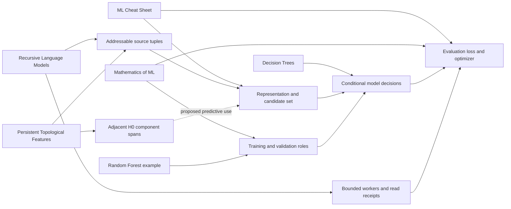
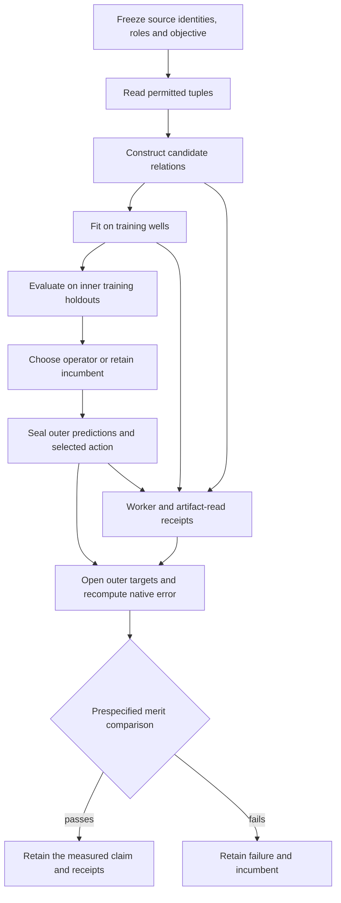

# Method references in the process and control graph

The six supplied PDFs inform how a candidate is represented, fitted, searched and evaluated. The graph connects each cited concept to a Python definition and an existing check. A local verifier resolves those links against the source manifest and Python AST. The concepts describe the use of each source in this project. Predictive merit comes from the wellbore measurements. [Machine-readable cross-reference](../qa/method_references.json) · [Verified source graph command](../scripts/verify_method_graph.py)



Physical PDF pages are counted from one. The current attachments have the same SHA-256 identities as the previously reviewed copies. Those identities are recorded in the machine-readable graph.

| Source and pages | Current use | Evidence required for the related decision |
| --- | --- | --- |
| *Recursive Language Models*, pp. 2, 4–8 | Addressable source, restricted working views and bounded delegated work. The paper's language-model inference is the reference for this control pattern. | Count measurements read, revisits, worker cost and end-to-end execution. A declared dependency needs a consumed artifact receipt. |
| *Machine Learning Cheat Sheet*, pp. 17–18, 57–59, 71–73 | Representation, evaluation and optimization remain explicit across tree, forest, neural and graph consumers. | Use identical observation roles, whole-well folds and original target rows. Report the optimizer budget for each learner. |
| *Mathematics of Machine Learning*, pp. 46, 50–55, 75, 82–89, 94, 104–107, 116 | Model selection, losses, regularization, kernels, neural models and diffusion support distinct choices of predictor and relation transport. | An empirical gain needs held-well error. Threshold or schedule selection uses inner training roles before the outer prediction seal. |
| *Classifier Series – Decision Trees*, pp. 1, 6–9 | A conditional split routes a sample. Fitted importance describes that estimator's feature use. | Verify the actual split/learner and its held-row output. The example's two evaluation summaries differ, so its numbers supply no wellbore benchmark. |
| *Random Forest – Predictive Maintenance*, pp. 9–12 | Ensemble construction and a concrete split-order counterexample. Page 10 resamples before splitting. | Assign well roles before fitting or resampling. Authenticate each member's training group and keep the final confirmation population outside selection. |
| *Persistent Topological Features in Large Language Models*, pp. 3–7 | Stable sample identities and intersections of adjacent complexes allow components and cycles to be followed across layers. | Specify vertices, simplices, intersection maps and revision index. Measure births/splits/deaths before claiming persistence. |

The supplied references cover mathematical learning, statistical decisions and representation analysis. Physical interpretation of a wellbore relation also needs its declared quantities, units, geometry and observation support. MD, survey coordinates and TVT use feet in the prediction path. The optional Network Engine bridge declares its conversion to metres. Measured-depth order, evidence rank, optimizer iteration and layer index retain separate meanings. [Typed source and relation axes](NODAL_HARNESS.md#typed-observations-and-neighbor-axes) · [Network Engine boundary](NETWORK_ENGINE_INTEGRATION.md)

The OODA analogy gives each pass through this graph a concrete record. Observe reads source tuples and support. Orient constructs candidate relationships and their comparison scores. Decide selects an operator or the incumbent using the permitted training evidence. Act executes the sealed choice through a bounded worker. Its output and read receipts become evidence for subsequent work. Measured depth, evidence rank and graph revision are separate possible ordering axes.

The process graph controls which evidence may cross each boundary.



The public nodal controller implements source binding, role filtering, bounded workers, artifact-read checks and independent station error replay. Its fixed experiments specify each candidate in advance. The training-bank selector now chooses among OFF, affine GR and merit-ordered Julia using excluded training-well predictions. The caller authenticates each bank's model and original station keys. Selection across graph, tree, forest and neural models under one shared resource budget remains a proposed extension. [Current implementation and scope](NODAL_HARNESS.md) · [Measured candidate decisions](MASTER_ITERATION.md)

The component-span implementation now computes exact adjacent maps between graph revisions. Each shared connected component belongs to one component on each side. Changes in those maps expose local splits and merges while retaining original vertex keys. A field diagnostic processed 3,690 adjacent pairs of 512-ft measurement windows, with 807 splits and 730 merges. Rotating the observed GR changed 3,938 of 4,109 candidate masks and yielded 740 splits and 701 merges. An independent SciPy replay matched every aggregate. This measures connected candidate depth states under a fixed loss threshold. Local evidence root `4dbcc15d86c442c954cafde5bcb93513d6d32c9afd15a2e2b4aef94b7a4abe50`. [H0 component API](../src/rwt/relation_history.py) · [Tests](../tests/test_relation_history.py)

The selector returns OFF for missing support, an undersized bank, an exact tie or an uncertain improvement against OFF. It verifies disjoint outer roles and exact bank membership before comparing per-well native squared errors. In the field test it chose OFF on 804 of 1,857 member queries, including 609 with mandatory unsupported status. The selected path scored 9.980316 ft but improved only one of three folds against the historical merit path, so its predictive gate failed. The training decision and its observed outer merit have separate receipts. [Selector API](../src/rwt/operator_selection.py) · [Tests](../tests/test_operator_selection.py)

```python
from rwt.relation_history import GraphRevision, component_history

before = GraphRevision("well-A/depth-grid", "before", ("a", "b", "c"), (("a", "b"), ("b", "c")))
after = GraphRevision("well-A/depth-grid", "after", ("a", "b", "c"), (("a", "b"),))
span = component_history([before, after]).spans[0]
```

The remaining extensions have explicit next checks.

| Proposed component | First discriminating check |
| --- | --- |
| Persistent barcode intervals and higher-order features | Extend the exact adjacent component maps across a complete revision sequence and define filled faces before tracking cycle intervals. Compare any predictive use with a shuffled evidence schedule. |
| General nested model and operator selection | Extend the measured three-action bank selector to graph, tree, forest and neural consumers at a shared observation and resource budget. Retain the outer-target mutation, absent-support OFF, always-incumbent and always-on comparisons. |

## Verify the cross-reference

From the repository root, use a fresh output directory. The optional PDF directory authenticates the actual source documents by bytes. Without it, the verifier checks citation ranges, concept status, source definitions and AST links.

```powershell
.\.venv\Scripts\python.exe scripts/verify_method_graph.py --pdf-dir $referencePdfDirectory --out $freshOutputDirectory
```

The output contains the concept graph, data and control links, source dependency graph and AST node IDs for every linked operator and check. An unresolved Python definition, an out-of-range citation or a proposed component incorrectly marked as implemented fails verification. Physical page counts are independently pinned to the authenticated PDF hashes. Test results remain separately recorded by the normal test runner. [Verifier tests](../tests/test_method_graph.py)

The updated graph resolves six documents, ten concepts and 59 links. Its SHA-256 is `d5863242b14d8df869d86ac4d44ec67bc048fe297427479b09519313ecaacd72`. Its adjacent source and AST graphs record the definitions at verification. All six attached PDFs matched their earlier authenticated copies. Blank physical pages 60 and 74 of the cheat sheet were excluded from the revised citations.
