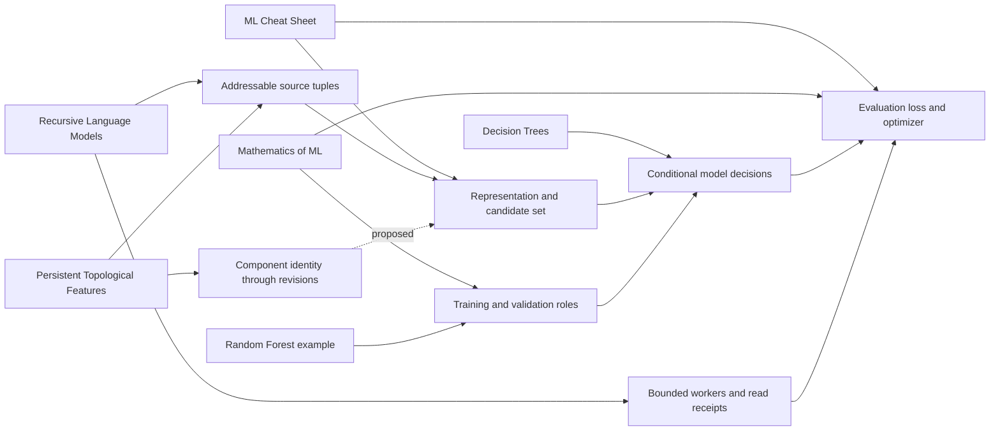
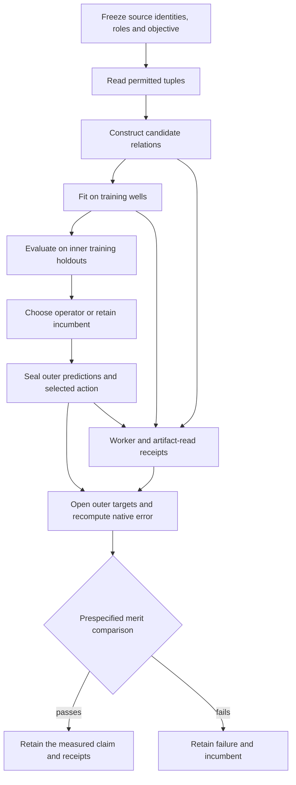

# Method references in the process and control graph

The six supplied PDFs inform how a candidate is represented, fitted, searched and evaluated. The graph connects each cited concept to a Python definition and an existing check. A local verifier resolves those links against the source manifest and Python AST. The concepts describe the use of each source in this project. Predictive merit comes from the wellbore measurements. [Machine-readable cross-reference](../qa/method_references.json) · [Verified source graph command](../scripts/verify_method_graph.py)



Physical PDF pages are counted from one. The current attachments have the same SHA-256 identities as the previously reviewed copies. Those identities are recorded in the machine-readable graph.

| Source and pages | Current use | Evidence required for the related decision |
| --- | --- | --- |
| *Recursive Language Models*, pp. 2, 4–8 | Addressable source, restricted working views and bounded delegated work. The paper's language-model inference is the reference for this control pattern. | Count measurements read, revisits, worker cost and end-to-end execution. A declared dependency needs a consumed artifact receipt. |
| *Machine Learning Cheat Sheet*, pp. 17–18, 57–59, 71–73 | Representation, evaluation and optimization remain explicit across tree, forest, neural and graph consumers. | Use identical observation roles, whole-well folds and original target rows. Report the optimizer budget for each learner. |
| *Mathematics of Machine Learning*, pp. 46, 50–55, 75, 82–89, 94, 104–107, 116 | Model selection, losses, regularization, kernels, neural models and diffusion support distinct choices of predictor and relation transport. | An empirical gain needs held-well error. Threshold or schedule selection uses inner training roles before the outer prediction seal. |
| *Classifier Series – Decision Trees*, pp. 1, 6–9 | A conditional split routes a sample. Fitted importance describes that estimator's feature use. | Verify the actual split/learner and its held-row output. The example's two evaluation summaries differ, so its numbers supply no wellbore benchmark. |
| *Random Forest – Predictive Maintenance*, pp. 9–12 | Ensemble construction and a concrete split-order counterexample. Page 10 resamples before splitting. | Assign well roles before fitting or resampling. Authenticate each member's training group and keep the final confirmation population outside selection. |
| *Persistent Topological Features in Large Language Models*, pp. 3–7 | Stable sample identities and intersections of adjacent complexes allow components and cycles to be followed across layers. | Specify vertices, simplices, intersection maps and revision index. Measure births/splits/deaths before claiming persistence. |

The supplied references cover mathematical learning, statistical decisions and representation analysis. Physical interpretation of a wellbore relation also needs its declared quantities, units, geometry and observation support. MD, survey coordinates and TVT use feet in the prediction path. The optional Network Engine bridge declares its conversion to metres. Measured-depth order, evidence rank, optimizer iteration and layer index retain separate meanings. [Typed source and relation axes](NODAL_HARNESS.md#typed-observations-and-neighbor-axes) · [Network Engine boundary](NETWORK_ENGINE_INTEGRATION.md)

The process graph controls which evidence may cross each boundary.



The public nodal controller implements source binding, role filtering, bounded workers, artifact-read checks and independent station error replay. Its fixed experiments specify each candidate in advance. The complete learned choice at **Choose operator or retain incumbent** is a proposed extension. The latest member-gain study tests a narrower train-only calibration decision. It does not implement every graph, ML and NN choice in this diagram. [Current implementation and scope](NODAL_HARNESS.md) · [Measured candidate decisions](MASTER_ITERATION.md)

The two proposed nodes in the cross-reference graph have explicit next checks.

| Proposed component | First discriminating check |
| --- | --- |
| Persistent identity through relation revision | Construct keyed candidate-state complexes before and after an evidence update, with their intersection. Preserve one component while its members change, then remove and restore its only bridge. Track the resulting component transitions and compare any predictive use with a shuffled evidence schedule. |
| Nested operator selection with an incumbent option | Let inner training wells select a schedule, threshold or incumbent. Change outer true TVT and require the chosen action and forecast to remain identical. Independently verify incumbent selection where support is absent. Compare outer scores with always-incumbent and always-on controls. |

## Verify the cross-reference

From the repository root, use a fresh output directory. The optional PDF directory authenticates the actual source documents by bytes. Without it, the verifier checks citation ranges, concept status, source definitions and AST links.

```powershell
.\.venv\Scripts\python.exe scripts/verify_method_graph.py --pdf-dir $referencePdfDirectory --out $freshOutputDirectory
```

The output contains the concept graph, data and control links, source dependency graph and AST node IDs for every linked operator and check. An unresolved Python definition, an out-of-range citation or a proposed component incorrectly marked as implemented fails verification. Physical page counts are independently pinned to the authenticated PDF hashes. The reference audit resolved six PDF identities, eight concepts and 47 links. Test results remain separately recorded by the normal test runner. [Verifier tests](../tests/test_method_graph.py)

The local verified concept graph has SHA-256 `ebffcf65d0c43697f2a35471da07db90e4ec2680feb144fb083afe8c6f763195`. Its adjacent source and AST graphs record the current definitions at verification. All six newly attached PDFs matched their earlier authenticated copies. Blank physical pages 60 and 74 of the cheat sheet were excluded from the revised citations.
