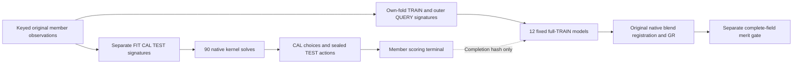

# Direct native-loss kernel models

These first-party studies replace iterative neural fitting with one regularized linear-system solve per model. They test whether a relationship signature predicts useful endpoint shifts, then test the complete field route. Both protocols, computational sources and controls were frozen before either study's results. The complete field comparison ran irrespective of the preceding member-calibration result. Neither primary passed its predictive gate; the retained development route remains **9.988991 ft**.

## Native value and relational representation

Each case keeps the original station basis `Φ=[r(1−p), rp]`, with `r=1−exp(−s/512)` and `p=s/L`. Its endpoint correction `u` changes the original member curve by `Φu`. The keyed native objective is `SSE0 + 2bᵀu + uᵀMu`, where `M=ΦᵀΦ`. Its off-diagonal coupling is retained.

A 4,398-coordinate signature records four physical toe-phase quarters, 334 inherited section-context channels, twelve surveyed/activity channels, the 25 candidate-state identities and their GR relationships, and heel/support/Gram metadata. Weighted summaries retain finite-support fractions, raw measurement counts and physical gap resets. They pool within quarters; they do not preserve every within-quarter sequence detail. A partly observed GR bin represents a mean over its finite readings. Its represented station mass does not imply an instrument reading at every station.

Only FIT wells estimate coordinate moments and the radial bandwidth. Missing, constant and insufficiently supported coordinates remain inactive; other standardized values are clipped at ±8. Four declared feature blocks receive equal nominal scale. The two fixed kernels are `K=1+XXᵀ` and `K=1+exp(−D²/(2h²))`, with `h²` the median strictly positive squared Euclidean FIT-pair distance. The constant is regularized. Duplicate feature rows have exactly zero distance, and an all-identical FIT bank uses a declared bandwidth fallback.

Let `m` be the FIT mean original-station count, `H=blockdiag(M_i/m)` and `h=stack(b_i/m)`, in case-major endpoint order. The solver minimizes **summed native SSE divided by m**, plus `0.1` times the vector RKHS squared norm. Its representer coefficients satisfy:

`(K ⊗ I₂ + 0.1 H⁻¹) a = −H⁻¹ h`.

Binary64 Cholesky solves the positive-definite system, including duplicate-input cases. Query endpoints are `(K_query ⊗ I₂)a`, clipped componentwise to ±64 ft. This solves the unconstrained regularized FIT problem; clipping is a separate deployment rule. There are no training epochs or optimizer states. Dividing the FIT sum by the number of wells without rescaling the penalty would change the estimator.

Independent synthetic original-station least squares and alternative factorizations checked the algebra, endpoint ordering and regularization scale. Actual case replay checked the source, native row footprints and every fitted coefficient's first-order condition. Source code, raw data and fitted artifacts remain local under the [first-party rule](../AGENTS.md).

## A: separate FIT/CAL/TEST member calibration

The [neural calibration study's](NEURAL_MERIT_CALIBRATION.md) 45 roles were retained: each of nine original 308 predictors excluded its entire bank, partitioned into 81–84 FIT, 27–28 CAL and 27–28 TEST wells. Ninety fresh linear/RBF solves used FIT-only signatures. All forecasts were sealed before CAL objective release. Leave-own-CAL-well-out amplitudes and the public one-SE rule selected a family; all 45 TEST actions were then sealed before TEST objectives opened. The earlier adaptive neural policy supplied a fixed comparator, with its original TEST predictions and no historical errors passed to the new learner or selector.

The largest systems were 162–168 square. Calibration chose 35 OFF, seven linear and three RBF actions, affecting 272 of 1,238 TEST records. Admitted amplitudes ranged from 0.594690 to 1, with median 1. Every record remained in the score. The table covers 619 distinct wells in two upstream contexts and 6,068,854 original-station appearances, before the full ensemble or field registration.

| TEST readout | Native RMSE (ft) | Adaptive minus control | Winning outer contexts |
| --- | ---: | ---: | ---: |
| OFF | 12.322270 | +0.046235 | 1/3 |
| Always linear | 12.398559 | −0.030054 | 2/3 |
| Always RBF | 12.216060 | +0.152445 | 1/3 |
| Admitted family at 0.5 | 12.290448 | +0.078057 | 0/3 |
| Admitted family at 1, diagnostic | 12.372197 | −0.003692 | 2/3, one tie |
| Historical adaptive neural policy | 12.321495 | +0.047010 | 1/3 |
| Adaptive kernel, primary | **12.368505** | — | — |

The fixed primary gate failed. Its difference from OFF had paired whole-well 95% interval −0.128863 to +0.221425 ft. Against admitted-half, the interval was +0.001804 to +0.164854 ft. Always-RBF improved over OFF as a comparator; it did not replace the failed calibrated primary. Four thousand bootstrap draws grouped both appearances of each original well ID. Overlapping fitting sets and shared predictors limit independent-sampling interpretations.

All 4,952 held endpoint pairs replayed from saved coefficients. An independent Cholesky-whitened solver, with separately calculated distances, differed by at most 1.53×10⁻¹² ft. Direct reconstruction of every original member curve and **42,481,978 action–station residuals** recovered all seven actions' errors within 1.91×10⁻⁸ ft² per well. All 154 confirmation wells were excluded.

The 90 matrix-construction/solve/optimality intervals totalled 4.93 worker-seconds. The 45 fit workers, including inference and saves, spanned 8.79 seconds with 26.31 summed worker-seconds. Descriptor preparation spanned 12.82 seconds with 38.38 summed worker-seconds. These are phase timings on one CPU BLAS thread per worker, with three concurrent independent workers. They exclude custody, calibration and audit time. The earlier neural study used a different representation and model class; the timing difference alone is not an accuracy-matched speedup.

## B: independently fixed complete field comparison

Each outer fold fitted four kernels to its 412/413 original BANK cases: RBF primary, linear, RBF with misregistered local GR, and RBF with local activity amplitudes removed. All upstream models, feature scalers, bandwidths and fitted coefficients excluded that fold's outer queries. The field source was frozen before A outcomes and consumed only A's authenticated completion marker. It used none of A's selected families, learned amplitudes, scores or feature scalers.

Misregistration rotated finite observed GR within physical 512-MD-ft sections while retaining locations, availability and sensor counts. Candidate residuals and consecutive-bin differences were reconstructed from those rotated measurements. The context control removed the two explicit local GR amplitudes and seven candidate activity channels while retaining coverage, geometry, all 334 inherited context channels and heel metadata. It tests incremental local evidence, not absence of all GR information.

The twelve systems were 824–826 square. A global training seal preceded query inference. All 7,428 member/arm endpoint pairs replayed exactly from the saved coefficients, and an alternative factorization matched within 3.77×10⁻¹² ft. No query coordinate required endpoint clipping. Each original raw member received its full native correction, then the unchanged half-full/half-three-member blend, registration and the fixed 416 ordinal, 13 same-lateral GR, 189 TRAIN-conditioned GR and one OFF routes ran on that arm's own curve. No extra calibration amplitude or heel reliability multiplier was applied to the kernel correction.

| Complete field readout | Blend | Registered | Ordinal | Added self-GR | Final |
| --- | ---: | ---: | ---: | ---: | ---: |
| Incumbent coherent decoder | 10.477118 | 10.234576 | 9.997405 | 9.994968 | **9.988991** |
| Zero member correction | 10.648607 | 10.433145 | 10.214733 | 10.212335 | 10.207287 |
| RBF primary | 10.574196 | 10.271097 | 10.080482 | 10.078787 | 10.073244 |
| Linear | 10.655270 | 10.312639 | 10.144434 | 10.142430 | 10.137169 |
| Misregistered RBF | 10.573061 | 10.271039 | 10.078673 | 10.076851 | 10.071331 |
| Context-only RBF | 10.667949 | 10.347832 | 10.138382 | 10.136990 | 10.131859 |

All entries are native RMSE in feet over 619 development wells and 3,034,427 original toe stations. RBF's final folds were 9.427860, 9.753364 and 10.972542 ft. It lost every fold to the incumbent, with pooled difference **+0.084253 ft**, paired interval **−0.018250 to +0.199605 ft**. It also missed misregistered RBF pooled by 0.001913 ft and won only one fold; that interval was −0.034880 to +0.036248 ft. Correct local GR pairing was not distinguished by this test.

RBF beat linear, context-only and zero correction in all three folds, by 0.063924, 0.058615 and 0.134042 ft pooled. This partial improvement did not meet the fixed complete-field gate against the incumbent and all three learned controls. The original-support 416 wells scored 9.921842 ft versus incumbent 9.853287; the remaining 203 scored 10.379866 versus 10.264410 ft. The retained predictor and confirmation seal remain unchanged.

Source-observation replay independently regenerated all learned blends and registrations, then all 2,476 arm/well GR readouts at every downstream stage before target release. Original-row scoring independently recovered all six methods, five stages, folds, strata and 4,000 whole-well bootstrap intervals. The final union closure rehashed 2,406 directly bound files, including the source CSVs as opaque bytes and all nine producer and nine field-worker records. These are repeated-development results, without independent confirmation or an external rank claim.

B feature workers totalled 49.58 seconds; fitting, evaluation and checkpoint workers 32.80 seconds, including 15.70 seconds in kernel construction/solve/optimality checks. Twice-loaded query inference totalled 48.77 worker-seconds. The complete native field workers totalled 101.15 seconds. Descriptor construction, dense distances, serialized model basis and downstream processing remain real costs even though fitting needs no epochs.

A separate follow-up used four kernel-derived inputs in the retained tree decoder instead of applying the kernel correction directly. Matching inputs scored 10.016188 ft versus incumbent 9.988991 ft and permuted inputs 10.001499 ft, failing both gates. Its different FIT and production kernel populations and complete native controls are recorded in the [decoder-feature study](KERNEL_FEATURE_DECODER.md).

## Evidence identities

- A/B design: `a739464a22b8afd7b66bf650b4704b5224935d3baa823489a1682803a615997f` and `8579e07f7f741bcc4bea172a611b371078213930cba5d24c7ae78b8a5ce00398`.
- A forecast seal: `06baa94dea08a35630d87d924653e0638ea0f7892febacb8a24476bf1d7a689f`.
- A custody/scoring root: `63e3c79835d5c5e5cb2d9b76ca5b0ad9e0c8aaf5a29776f7e47653975f00afa9`.
- A literal-row audit: `e527bf40250e0c5fd01196f56f74ade7decdd82acb67ae0768e509547d3908fd`.
- B producer root: `0fe8682c579334e0bad212e0dcab01cf160210875223ce5a3eca3e1f9bac3ddc`.
- B all-member query seal: `98bcbd8aecd6cb31d4639c1298c46af75939aa630a16a6b8b44f08550226531e`.
- Reviewed B native seal: `2509a7a61493f063c663be3dc6de2aa33ab528301e7fc8d6023a551291a309ac`.
- B field verification: `2f0ddea9e5721fb2084f4267edf26584715e5152e2102359632d7aeebe0b12b3`.
- B independent native score: `2fbddc83f6ee299a06d7e0d986c013e27f02c4248db8ec29250c549379787935`.
- B union closure: `8d3349338941a4f35c5a0867e4f69b7d97fa49909e6eef5fe1c853e06664f878`.
