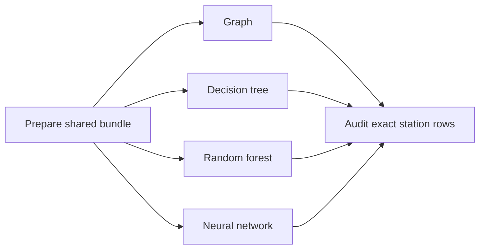

# Nodal readouts on the same well measurements

The decision tree, random forest and neural network each gained accuracy from the added relationships on the fixed 12-well development pilot. Carrying forward the last visible TVT still had the lowest error, **11.617 ft RMSE**. Revising the graph's edge weights made its path less accurate. The six-stage computation and both numerical checks completed. All four candidates fell short of the two predictive comparisons required for development admission.

## Reproduce or verify a run

From the repository root, use the project Python environment and a competition data directory containing the paired training CSVs. The manifest supplies the fixed pilot and the disjoint development and confirmation roles. Each execution requires a fresh output directory. These PowerShell commands create and verify a new pilot.

```powershell
$python = ".\.venv\Scripts\python.exe"
$cohort = "artifacts/master_iteration_001/cohort/cohort_manifest.json"
$data = "data/raw/rogii-wellbore-geology-prediction"
$run = "artifacts/nodal_mission_replay_001"
& $python -B scripts/run_nodal_harness.py --cohort $cohort --data-root $data --out $run
& $python -B scripts/run_nodal_harness.py --verify $run
```

On a fresh checkout, create the cohort manifest before running the launcher. With `$python` and `$data` set as above, run the following once in a fresh output location. It assigns roles by well ID, hashes the source files and copies the 12 pilot pairs. [Cohort builder](../scripts/prepare_master_cohort.py)

```powershell
& $python scripts/prepare_master_cohort.py --data $data --out artifacts/master_iteration_001/cohort --pilot-data artifacts/nodal_pilot_inputs
```

Use `--all-development` and a different output directory for the full development comparison. To check the original pilot evidence on its originating checkout, run `python -B scripts/run_nodal_harness.py --verify artifacts/nodal_mission_001`. Verification is read-only and requires the original source bytes, raw files and recorded path layout. A new execution records new processes and timings. [Launcher](../scripts/run_nodal_harness.py) · [Worker](../scripts/nodal_worker.py)

## From a source reading to a depth prediction

A reading is identified by well, table, zero-based row and channel. Preparation preserves parsed values and row order from lateral MD, X, Y, Z, GR and visible TVT, together with reference TVT and GR. Each toe block contains up to eight consecutive original stations. Its first row and row count recover every scored station. A 45-degree drafting rotation retains along-track and cross-track coordinates from the same survey. The out-of-fold learners see whole wells held out together in three folds. Their target is the training block's mean hidden TVT minus its last visible TVT. Imputation and neural scaling use the training fold.

For example, the pilot's trace for well `7256229b`, block starting at row 1565, covers original rows 1565 through 1572. Its XYZ and GR keys point to row 1568, where GR is missing. Its TVT anchor comes from row 1556. The incoming edge's initial weight of 0.6948 fell to 0.6771 after revision. The outgoing edge retained its weight of 0.5411. The bundle records one supported message hop on the left and four on the right for this block. [Bundle and trace implementation](../src/rwt/nodal_bundle.py)

The graph evaluates 41 TVT offsets from −100 to +100 ft in 5-ft steps. Local costs compare the block's GR with the paired typewell using visible-heel calibration. Changes in GR and survey direction set the initial continuity between consecutive blocks. Forward and backward messages propagate for up to four edges. At each edge, the algorithm measures the minimum additional cost needed to reconcile the preferred states on its two sides under a stay-or-one-bin move. If that cost is $q$, the revised weight is $w/(1+q)$. A second message pass uses the revised weights. The final path backtrace uses the complete well, so this experiment measures offline placement.

The graph control uses the initial weights and the same path decoder. For the learned arms, the control trains the same estimator on 92 original block features. The augmented view includes 50 additional columns covering the drafting coordinates, local edge weights and revisions, supported hop counts, chosen depth offset and the 41 path costs. This comparison measures the combined feature set. The graph control isolates the weight revision. The same underlying survey or GR reading can contribute to several columns. [Readouts and grouped training](../src/rwt/nodal_study.py) · [Relational methods and evidence](RELATIONAL_METHODS.md)

## Pilot results

The 12 wells supplied 54,833 toe stations in 6,860 blocks. Preparation built 6,848 within-well edges, revised 4,067 weights and assigned zero weight to 551 edges. The table reports pooled station RMSE in feet. The well count uses a strict reduction in each well's summed squared error against its matched control.

| Readout | Augmented | Matched control | Wells improved out of 12 |
| --- | ---: | ---: | ---: |
| Graph path | 36.564 | 33.717 | 4 |
| Decision tree | 13.517 | 15.328 | 7 |
| Random forest | 13.258 | 13.402 | 7 |
| Neural network | 15.044 | 18.920 | 8 |

The admission test requires strictly lower pooled squared error than **both** last-visible TVT and the corresponding control. The last-visible comparator scored 11.617 ft on these same original stations. The pilot supplies development evidence only. Confirmation wells and competition test rows were outside its population.

### Where the time went

The following wall times come from the bounded subprocess receipts. The two fit columns sum separately timed preprocessing, fitting and prediction across the three folds. Each learned arm ran six fits total. The neural network completed 24 epochs per fit. Preparation includes construction of both graph paths and every augmented feature, so the graph readout's process time alone understates its cost.

| Stage | Process wall time (s) | Augmented fit and predict (s) | Control fit and predict (s) |
| --- | ---: | ---: | ---: |
| Prepare shared bundle | 3.22 | — | — |
| Graph readout | 1.99 | — | — |
| Decision tree | 3.33 | 0.75 | 0.43 |
| Random forest | 4.33 | 1.29 | 0.97 |
| Neural network | 4.70 | 1.49 | 1.19 |
| Audit | 2.09 | — | — |

The six process times sum to 19.66 seconds. The first process start through the final process finish occupied 20.47 seconds. That interval excludes initial planning and final verifier replay. Preparation recorded 1.12 seconds inside the worker for bundle construction and persistence. These measurements combine startup, I/O and computation on one machine. Peak memory, energy, standalone inference latency and an equal-accuracy speedup remain unmeasured.

## What each record establishes

The controller follows the user-designated Mission Lab pattern of a structured specification, operator dependencies, bounded workers, receipts, verification and a separate merit decision. The public RWT implementation uses its own scientific operators and process launcher. [Mission Lab design reference at `dfdf8b7`](https://github.com/ZuluYokohama/mission-lab/tree/dfdf8b7dded59f06d0fc2bc581a9292de305e977)



| Record under the run directory | What the verifier checks |
| --- | --- |
| `contract.json` | Development well order, cohort digest, hashes of paired raw inputs, seed 42, three folds, stage dependencies and declared process bounds. |
| `source_graph.json`, `ast_graph.json` | The launcher, worker, emitter and recursively resolved first-party imports. Every file has a source digest and parse-tree digest. The AST projection records statements, definitions, calls and control relationships. The pilot had 16 files, 5,518 projected nodes and 5,502 syntax edges. Dynamic call resolution and external package binary identity lie outside this evidence. |
| `bundle.npz`, `bundle.json`, arm archives and metadata | Raw measurement identity, source-row incidence, per-well boundaries, graph edges, fold assignment and identical output block keys across arms. The score audit expands each block prediction to its original stations and computes pooled, per-well and per-fold errors. |
| `trace.jsonl`, per-stage receipts and logs | Six processes generated 12 chained start/finish events and eight dependency edges. The verifier checks commands, PIDs, terminal statuses, artifact and log digests, and dependencies against the specification. Execution dispatches one worker at a time under a 1,800-second wall bound per stage. |
| `metrics.json`, `execution_evidence.json` | Replay of the scientific audit plus a separate calculation using within-block variance and block means. The two calculations agree on every method's per-well and pooled station error to the verifier's numerical tolerance. |

The second calculation uses the identity $\sum_i(y_i-p)^2 = \sum_i(y_i-\bar y)^2 + n(\bar y-p)^2$ within each block. It reopens the source rows and compares both the reconstructed footprint and numerical error. The local evidence root for this pilot is `30aa258536320a0cad81ace22ac8e62d5b167361aa5c1625d5c76b9a65251862`. The digest chain provides local integrity checks. Independent attestation, external signing and production acceptance require separate evidence. Jovin enrollment covers its declared source inventory and AST gates. [AST emitter](../src/rwt/ast_evidence.py) · [Execution primitives](../src/rwt/execution_graph.py) · [Jovin enrollment](JOVIN_ENROLLMENT.md)
