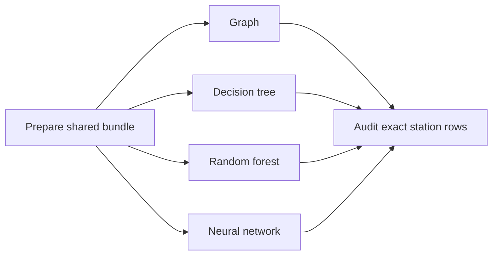

# Nodal readouts on the same well measurements

On 619 development wells the random forest with the shared nodal features scored **15.037972 ft RMSE**. Its matched forest scored **15.111924 ft**, and carrying forward the last visible TVT scored **15.993630 ft**. Only the forest passed both pooled-error comparisons. The 95% paired well-bootstrap interval for its difference from the matched forest includes zero. The six planned stages executed on both the fixed 12-well pilot and the larger cohort, and independent numerical checks reproduced every method's station error.

## Reproduce or verify a run

From the repository root, use the project Python environment and a competition data directory containing the paired training CSVs. The manifest supplies the fixed pilot and the disjoint development and confirmation roles. Each execution requires a fresh output directory. These PowerShell commands create and verify a new pilot.

```powershell
$python = ".\.venv\Scripts\python.exe"
$cohort = "artifacts/master_iteration_001/cohort/cohort_manifest.json"
$data = "data/raw/rogii-wellbore-geology-prediction"
$run = "artifacts/nodal_mission_replay_001"
& $python -B scripts/run_nodal_harness.py --cohort $cohort --data-root $data --out $run
& $python -B scripts/run_nodal_harness.py --verify $run
```

On a fresh checkout, create the cohort manifest before running the launcher. With `$python` and `$data` set as above, run the following once in a fresh output location. It assigns roles by well ID, hashes the source files and copies the 12 pilot pairs. [Cohort builder](../scripts/prepare_master_cohort.py)

```powershell
& $python scripts/prepare_master_cohort.py --data $data --out artifacts/master_iteration_001/cohort --pilot-data artifacts/nodal_pilot_inputs
```

Use `--all-development` and a different output directory for the full development comparison. To check the original pilot evidence on its originating checkout, run `python -B scripts/run_nodal_harness.py --verify artifacts/nodal_mission_001`. Verification is read-only and requires the original source bytes, raw files and recorded path layout. A new execution records new processes and timings. [Launcher](../scripts/run_nodal_harness.py) · [Worker](../scripts/nodal_worker.py)

To inspect the result visually, generate an offline HTML report. It verifies the saved run, draws its executed dependency edges and lets you expand each source file to inspect imports, branches and call expressions. Under **Trace a block**, one original reading and its incident edges share a well and row key with four saved predictions and their controls. This identifies the model row that consumed the observations. Supply a fresh HTML filename. [Report generator](../scripts/render_nodal_evidence.py)

```powershell
& $python -B scripts/render_nodal_evidence.py $run "$run/evidence.html"
```

## Typed observations and neighbor axes

`pack_well_observations` accepts the complete parsed lateral and its paired typewell. Each value keeps its address `(well, table, source row, channel)`, a declared unit and a validity bit. The lateral supplies MD, XYZ, GR and visible `TVT_input`. The typewell supplies its own TVT and GR on a separate row axis. `to_structured()` returns contiguous typed tuples with named values, source rows and presence fields. Curve-null encodings retain their original parsed value with presence set to false. Coordinate values retain their original units and scope.

`gather_md_neighbors` adds a fixed relation axis without resampling. Its arrays have shape `(receiver, requested MD offset, channel)`. The sender row and actual MD gap remain explicit. Ties resolve to the earlier source row. Out-of-domain or out-of-tolerance relations have sender `-1` and an all-false mask. Channel absence on an available sender remains independent of the row's other channels. [Observation tensor API](../src/rwt/observation_tensors.py)

```python
from rwt.observation_tensors import gather_md_neighbors, pack_well_observations

obs = pack_well_observations(well_id, lateral, paired_typewell)
source_tuples = obs.lateral.to_structured()
relations = gather_md_neighbors(obs.lateral, original_centers, [-64, 0, 64], tolerance_ft=4)
```

On 619 development wells, a separate audit recovered all 27,018,426 parsed lateral and reference values bit-for-bit, including recognized curve-null values. It matched the source IDs and values of all 2,630,300 available measured-depth relationships with an independent binary search. The receiver axis used the original 379,568 block centers and seven signed offsets. The audit selected only authorized survey, visible depth and reference columns. Local evidence root `1fed621f24edb07929d5362869dddcc50a5e63c0fa9de60301cded8052a3bd87`.

The optional Network Engine bridge exports MD, Z and GR as a separate view. On the fixed 12-well pilot, the typed inputs matched the bridge masks over all 74,988 source rows. The engine's `Stream.to_structured()` retained the original station ordinal and all declared values on 63,023 rows with joint MD/Z/GR support. The bridge converts MD and Z from feet to metres and retains GR in source units. The full inbound tensor keeps all fields and masks across gaps. Local comparison SHA-256 `bb63743ce14e9857c3dc8c5593fbf31b02663c6524c325f88327efe8378ceb07`. [Network Engine bridge](NETWORK_ENGINE_INTEGRATION.md)

## From a source reading to a depth prediction

A reading is identified by well, table, zero-based row and channel. Preparation preserves parsed values and row order from lateral MD, X, Y, Z, GR and visible TVT, together with reference TVT and GR. Each toe block contains up to eight consecutive original stations. Its first row and row count recover every scored station. A 45-degree drafting rotation retains along-track and cross-track coordinates from the same survey. The out-of-fold learners see whole wells held out together in three folds. Their target is the training block's mean hidden TVT minus its last visible TVT. Imputation and neural scaling use the training fold.

For example, the pilot's trace for well `7256229b`, block starting at row 1565, covers original rows 1565 through 1572. Its XYZ and GR keys point to row 1568, where GR is missing. Its TVT anchor comes from row 1556. The incoming edge's initial weight of 0.6948 fell to 0.6771 after revision. The outgoing edge retained its weight of 0.5411. The bundle records one supported message hop on the left and four on the right for this block. [Bundle and trace implementation](../src/rwt/nodal_bundle.py)

The graph evaluates 41 TVT offsets from −100 to +100 ft in 5-ft steps. Local costs compare the block's GR with the paired typewell using visible-heel calibration. Changes in GR and survey direction set the initial continuity between consecutive blocks. Forward and backward messages propagate for up to four edges. At each edge, the algorithm measures the minimum additional cost needed to reconcile the preferred states on its two sides under a stay-or-one-bin move. If that cost is $q$, the revised weight is $w/(1+q)$. A second message pass uses the revised weights. The final path backtrace uses the complete well, so this experiment measures offline placement.

The graph control uses the initial weights and the same path decoder. For the learned arms, the control trains the same estimator on 92 original block features. The augmented view includes 50 additional columns covering the drafting coordinates, local edge weights and revisions, supported hop counts, chosen depth offset and the 41 path costs. This comparison measures the combined feature set. The graph control isolates the weight revision. The same underlying survey or GR reading can contribute to several columns. [Readouts and grouped training](../src/rwt/nodal_study.py) · [Relational methods and evidence](RELATIONAL_METHODS.md)

## Pilot results

The 12 wells supplied 54,833 toe stations in 6,860 blocks. Preparation built 6,848 within-well edges, revised 4,067 weights and assigned zero weight to 551 edges. The table reports pooled station RMSE in feet. The well count uses a strict reduction in each well's summed squared error against its matched control.

| Readout | Augmented | Matched control | Wells improved out of 12 |
| --- | ---: | ---: | ---: |
| Graph path | 36.564 | 33.717 | 4 |
| Decision tree | 13.517 | 15.328 | 7 |
| Random forest | 13.258 | 13.402 | 7 |
| Neural network | 15.044 | 18.920 | 8 |

The admission test requires strictly lower pooled squared error than **both** last-visible TVT and the corresponding control. The last-visible comparator scored 11.617 ft on these same original stations. The pilot supplies development evidence only. Confirmation wells and competition test rows were outside its population.

### Where the time went

The following wall times come from the bounded subprocess receipts. The two fit columns sum separately timed preprocessing, fitting and prediction across the three folds. Each learned arm ran six fits total. The neural network completed 24 epochs per fit. Preparation includes construction of both graph paths and every augmented feature, so the graph readout's process time alone understates its cost.

| Stage | Process wall time (s) | Augmented fit and predict (s) | Control fit and predict (s) |
| --- | ---: | ---: | ---: |
| Prepare shared bundle | 3.22 | — | — |
| Graph readout | 1.99 | — | — |
| Decision tree | 3.33 | 0.75 | 0.43 |
| Random forest | 4.33 | 1.29 | 0.97 |
| Neural network | 4.70 | 1.49 | 1.19 |
| Audit | 2.09 | — | — |

The six process times sum to 19.66 seconds. The first process start through the final process finish occupied 20.47 seconds. That interval excludes initial planning and final verifier replay. Preparation recorded 1.12 seconds inside the worker for bundle construction and persistence. These measurements combine startup, I/O and computation on one machine. Peak memory, energy, standalone inference latency and an equal-accuracy speedup remain unmeasured.

## Full development results

The same recipe covered all 3,034,427 toe stations in 379,568 blocks across 619 wells. The 12 pilot wells are included in this population. Every arm improved pooled RMSE over its matched control. The table shows how often that also improved an individual well. For example, the tree's pooled improvement occurred despite lowering error on just 204 wells. Pooled station error gives greater weight to wells with more rows and larger errors.

| Readout | Augmented RMSE (ft) | Matched control (ft) | Wells improved vs. control | Paired RMSE change vs. control, 95% interval (ft) |
| --- | ---: | ---: | ---: | ---: |
| Graph path | 40.469240 | 40.500066 | 309 | −0.031 [−0.296, +0.197] |
| Decision tree | 16.062288 | 16.418008 | 204 | −0.356 [−0.774, +0.036] |
| Random forest | 15.037972 | 15.111924 | 307 | −0.074 [−0.165, +0.022] |
| Neural network | 18.655931 | 19.793604 | 333 | −1.138 [−2.143, −0.178] |

The forest beat last-visible TVT in all three folds. Its matched forest had lower error in one fold. The paired interval against last visible was −1.305 to −0.599 ft. The neural network improved against its matched control and scored 2.662 ft above last visible. For each interval, sort the well IDs lexically and draw 10,000 resamples of 619 whole wells with replacement using NumPy PCG64 seeded with 42. Each replicate uses the same sampled wells for all arms. Compute each RMSE as the square root of summed squared error divided by summed row count, then take the linear 2.5th and 97.5th percentiles of the paired differences. The intervals hold predictions fixed and omit retraining variation and possible geographical dependence between wells.

The backward revision changed 237,451 of 378,949 edge weights. The decoder then selected different offsets on 15,228 blocks covering 121,738 original stations (4.01%). Among the 573 wells with at least one change, 309 improved and 264 worsened. The other 46 kept the same path. This establishes that later evidence can change earlier weights and that some changes reach the output. The graph arm's 40.469240 ft remains well above the 15.993630 ft carry-forward baseline.

Process wall times were 63.66 seconds for shared preparation, 2.58 for graph export, 122.05 for the tree, 189.55 for the forest, 147.63 for the neural network and 8.02 for the audit. Each learner's time includes both feature views and three folds. For the forest, the timed fit-and-predict calls totaled 102.6 seconds with the augmented view and 80.5 with the control. Both neural views used 24 epochs per fold. The local receipt root is `2ec15f999a2aa9ae7ea9a9338e87c762e8aba6f3618094fe19a8a661c1a234ff`. The machine used Python 3.12.10, NumPy 2.5.5, pandas 3.1.1, SciPy 1.18.1 and scikit-learn 1.9.1.

## What each record establishes

The six supplied mathematical and ML references have a separate concept-to-source graph. Its verifier resolves cited concepts to operator definitions and checks against the current source and AST. This records reference use alongside the execution and numerical evidence below. [Process and control cross-reference](METHOD_REFERENCE_GRAPH.md)

The controller follows the user-designated Mission Lab pattern of a structured specification, operator dependencies, bounded workers, receipts, verification and a separate merit decision. The public RWT implementation uses its own scientific operators and process launcher. [Mission Lab design reference at `dfdf8b7`](https://github.com/ZuluYokohama/mission-lab/tree/dfdf8b7dded59f06d0fc2bc581a9292de305e977)



| Record under the run directory | What the verifier checks |
| --- | --- |
| `contract.json` | Development well order, cohort digest, hashes of paired raw inputs, seed 42, three folds, stage dependencies and declared process bounds. |
| `source_graph.json`, `ast_graph.json` | The launcher, worker, emitter and recursively resolved first-party imports. Every file has a source digest and parse-tree digest. The AST projection records statements, definitions, calls and control relationships. The pilot had 16 files, 5,518 projected nodes and 5,502 syntax edges. Dynamic call resolution and external package binary identity lie outside this evidence. |
| `bundle.npz`, `bundle.json`, arm archives and metadata | Raw measurement identity, source-row incidence, per-well boundaries, graph edges, fold assignment and identical output block keys across arms. The score audit expands each block prediction to its original stations and computes pooled, per-well and per-fold errors. |
| `trace.jsonl`, per-stage receipts and logs | Six processes generated 12 chained start/finish events and eight scheduling edges in the historical runs. The verifier checks commands, PIDs, terminal statuses, artifact and log digests, and dependencies against the specification. Execution dispatches one worker at a time under a 1,800-second wall bound per stage. |
| `<stage>.reads.json` (v2) | Each worker reports the upstream artifacts successfully parsed at its instrumented JSON and NPZ read boundaries. The launcher matches the digest of the parser's byte snapshot with the producing stage's output digest and binds the read report to its stage receipt and process. |
| `metrics.json`, `execution_evidence.json` | Replay of the scientific audit plus a separate calculation using within-block variance and block means. The two calculations agree on every method's per-well and pooled station error to the verifier's numerical tolerance. |

The second calculation uses the identity $\sum_i(y_i-p)^2 = \sum_i(y_i-\bar y)^2 + n(\bar y-p)^2$ within each block. It reopens the source rows and compares both the reconstructed footprint and numerical error. The local evidence root for this pilot is `30aa258536320a0cad81ace22ac8e62d5b167361aa5c1625d5c76b9a65251862`. The digest chain provides local integrity checks. Jovin separately accepted the enrolled source and AST and verified the native minimum-cost solver on 1,309 synthetic lattices. [AST emitter](../src/rwt/ast_evidence.py) · [Execution primitives](../src/rwt/execution_graph.py) · [Jovin enrollment and test scope](JOVIN_ENROLLMENT.md)

New missions use `rwt.nodal-mission.v2`. In the offline report dashed arrows show the eight scheduling dependencies. Solid arrows link each producer to workers that parsed at least one of its named outputs. Expanding **Worker artifact reads** shows one entry per read, including its SHA-256. Each of the four readouts consumes `bundle.npz`. The audit consumes that same archive directly from preparation and both the metadata and prediction archive from each readout. These thirteen reads form nine producer–consumer pairs. Preparation also produces `bundle.json` for display; its presence in the output inventory alone creates no worker read edge.

The application records completed artifact parses. Raw CSV access, operating-system activity, individual NPZ array accesses and model internals fall outside that record. A worker can exit successfully with a required read missing. In that case the controller retains the process receipt and missing artifact names and stops before issuing integration evidence. Version 1 archives retain their scheduling graph and can be verified against their original source snapshot. They contain no worker read reports.

The version 2 pilot ran all six workers on 12 wells and verified nine producer–consumer pairs from 13 artifact reads. The standalone verifier replayed numerical errors on all 54,833 original toe stations. The generated report exposes the scheduled and artifact edges alongside the original row trace, model outputs and source syntax. Local evidence root `1c575254bf02a5e560f4ae025d610c60fabbf3f900a6a16d03a77d2cc4f53ada`.
