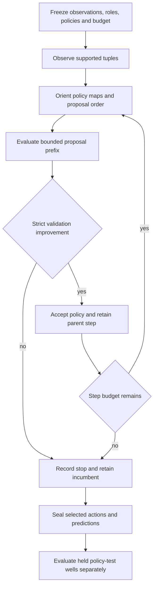
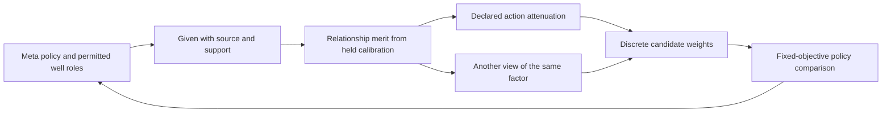

# Policy mapping in the OODA loop

A policy maps an observed condition to an operator or an OFF action. A policy mapper proposes changes to that map. The bounded adapter evaluates those proposals on fixed, permitted evidence, accepts strict objective decreases and records each examined state. This makes the user's higher-policy-to-discrete-action idea executable. [Public adapter](../src/rwt/policy_refinement.py) · [Behavior checks](../tests/test_policy_refinement.py)

Observe retains the original tuple identities and support. Orient constructs the policy neighborhood and proposal order. Decide measures the permitted objective and retains the incumbent unless a proposal improves it. Act installs the accepted policy for the next pass. A Julia sequence can order proposals using observed relationships. The independently measured objective controls acceptance.



## Adapter contract

`refine_policy` takes canonical policy IDs, an evidence digest, a support flag, a proposal callback, a deterministic objective callback and positive step/proposal bounds. The caller binds policy definitions, source identities, roles, station footprint and scoring semantics into the evidence digest. State IDs hash that digest together with the policy ID. The step trace retains the incumbent, examined proposals and accepted successor. Each distinct policy objective is evaluated at most once.

An accepted path strictly decreases the fixed finite objective. It therefore cannot revisit a previously accepted state on that evidence. The maximum number of objective calls is `1 + max_steps * proposal_limit`. The existing bounded worker supplies process time and resource supervision for callback execution. [Execution controller](NODAL_HARNESS.md)

| Stop | Meaning |
| --- | --- |
| `missing_support` | Return OFF without invoking the proposal or objective callback. |
| `stationary` | The examined prefix is empty or contains only the incumbent. |
| `no_improvement` | No examined proposal has a strictly lower objective. |
| `proposal_cycle` | Every examined proposal returns to an accepted ancestor. |
| `step_budget` | The allowed number of rounds has been consumed. The final round may have accepted an improvement. |

The proposal limit counts entries before deduplication. Stopping describes the examined neighborhood under this budget. Global optimality requires separate coverage evidence. Stability of a validation objective requires separate held-well evaluation before asserting predictive merit. The Julia recurrence itself may escape or vary without approaching a fixed point.

This synthetic example resolves one finite neighborhood. Its losses have arbitrary units.

```python
import hashlib
import json
from rwt.policy_refinement import refine_policy

loss = {"base": 4.0, "refined": 3.0}
edges = {"base": ["refined"], "refined": []}
frozen = json.dumps({"loss": loss, "edges": edges}, sort_keys=True).encode()
result = refine_policy(
    "base", off="base",
    evidence_sha256=hashlib.sha256(frozen).hexdigest(), supported=True,
    propose=lambda policy: edges[policy], objective=lambda policy: loss[policy],
    max_steps=3, proposal_limit=2,
)
assert result.policy == "refined" and result.stop_reason == "stationary"
assert result.objective_calls == 2
```

## Field study roles

The first policy study reuses nine original inner models' excluded-well prediction banks. Each bank is divided into five groups. Rotations reserve one group for the new policy test, one for adaptive validation and three for fitting leaf actions. The upstream model excluded the entire bank. The test wells have a history of development reuse. Repeated occurrences are grouped by original well ID when reporting uncertainty. A data custodian routes the archived errors into role packs. Each solver process receives its own fitting and validation errors, with its test errors omitted. The custodian has access to the historical outcome tables.

The fixed action choices are OFF, affine GR and merit-ordered Julia. The initial map splits visible-heel reliability at 0.25. Four predefined refinements use supported section count, merit reordering fraction, expected endpoint knot-shift contrast and opposing endpoint signs. These knot shifts precede the native `q/2` correction gain. A composed Julia descriptor orders proposals using fitting-well observations. A canonical schedule receives the same two-proposal width and three-round cap. An exhaustive-width check tests whether schedule order affects the result when every legal neighbor is examined.

Each leaf applies the existing training-bank support and one-standard-error rule. Children with six to eleven fitting wells retain OFF under its 12-well minimum. The search may accept that fallback if validation improves. Such a change measures a conservative action decision. Predictive admission uses the separately reserved policy-test errors and fixed controls. [Training-bank selector](../src/rwt/operator_selection.py) · [Measurements and admission decisions](MASTER_ITERATION.md)

The completed study failed that predictive gate. Same-member policy-test RMSE was 12.192375 ft with Julia ordering, 12.188605 ft with canonical ordering and 12.174820 ft with the static policy. Julia reduced validation SSE in 17 of 45 searches. The schedules agreed in all 45 exhaustive-width searches. Their finite stopping and validation improvement did not establish a better depth predictor. The public adapter remains a tested search control. [Full outcome and transfer controls](MASTER_ITERATION.md#policy-mapping-inside-a-bounded-ooda-loop)

## Adaptive weights across policy layers

`resolve_weights` installs the weight decisions in an explicit parent graph. Each node names its given/source, evidence, role scope, support and rule. A `Given` carries observed support. `HeldMerit` proposes `max(0, 1 - candidate_loss / baseline_loss)` from paired mean losses on the same calibration wells. `FixedWeight` carries a declared factor between zero and one. The loss ratio and the minimum bank size are study choices. They are distinct from the operator selector's one-standard-error rule. [Weight graph API](../src/rwt/merit_weights.py) · [Checks](../tests/test_merit_weights.py)



The feedback arrow starts a new bounded decision pass. The weight dependency graph within each pass remains acyclic. Effective weights multiply each distinct ancestor factor once, even when two views share that ancestor. Unsupported or zero-weight parents switch dependent policies off. This product is a declared attenuation rule. It is not a probability of correctness or an independence claim about its sources.

Each held loss binds an ordered observation-key digest and count for both candidate and baseline. A nonempty merit bank must contain every declared calibration well exactly once. Calibration and query roles must be disjoint. Ambiguous case/Unicode spellings, conflicting factor provenance, cycles and missing parents are rejected. Decisions and graph receipts are immutable and hash their scope, evidence and parent decisions. The caller authenticates the underlying measurements and each calibration model's exclusion of its held wells.

```python
from rwt.merit_weights import (
    FixedWeight, Footprint, Given, HeldMerit, PairedWellLoss,
    WeightNode, WeightScope, resolve_weights,
)

# Synthetic paired losses; each supplied footprint represents 12 ordered keys.
wells = tuple(f"train-{i}" for i in range(8))
scope = WeightScope("example", wells, ("query",))
fp = Footprint(12, "a" * 64)
losses = tuple(PairedWellLoss(w, 1.0, 4.0, fp, fp) for w in wells)
graph = resolve_weights(scope, [
    WeightNode("meta", "example", "roles", "role-record", Given()),
    WeightNode("relation", "example", "paired-observations", "loss-record",
               HeldMerit("relation-skill", losses), ("meta",)),
    WeightNode("action", "example", "study-rule", "gain-record",
               FixedWeight("half-gain", 0.5), ("relation",)),
])
assert graph.decision("action").weight == 0.375
```

The installed field replay rebuilt the near-horizontal TRAIN-well calibration losses and original edge footprints. For the three outer scopes it recovered every adaptive weight and fixed half-gain descendant exactly. Those public-graph weights reproduced all 3,034,427 archived station forecasts across 619 wells byte-for-byte. Full fitted profile and model artifacts are retained in the local receipts. Rotated-training evidence had negative held merit and its dependent graph action switched off in every scope. The original rotation comparator used the true gain deliberately; it remains a separate measured control.

This replay verifies weight installation and native parity. It performs no new predictive search or scoring. The public regression test connects a proposed weight graph to `refine_policy` and verifies that positive calibration merit cannot admit an action that worsens its unchanged objective. Local replay root `0a75ec9b36b5bca44749157f799f8752cf56064f73e91ff3e699fe5aac757156`. [Field outcome and controls](MASTER_ITERATION.md)

## Two-way attention as a separate proposal mechanism

The user's transformer adaptation suggests policy queries attending to source-addressed given tokens, followed by returned evidence updating the policy context. The reverse pass must retain the given identities and masks. It needs its own comparison against one-way attention, a similar-size ordinary network and fixed actions under identical observation and optimization budgets. Attention proposes relevance; the weight graph and original-row predictive objective retain their own decisions. The reference graph records this extension as a hypothesis. The supplied neural-network and recursive-context references inform the general construction, without supplying a wellbore attention implementation.

A further placement is a policy-context adapter around complete-field predictions. A meta token carries permitted roles, objectives and the current policy state. Local tokens carry the original observation keys, condition/activity descriptors, relation masks and candidate actions. A forward attention pass proposes local action weights; a return pass aggregates supported relationships and permitted calibration residuals into a proposed successor policy. Hidden query outcomes cannot enter that return pass. Every target-dependent summary inherits the contributing labels through the [lineage graph](LABEL_LINEAGE.md).

The sequence axis must be declared: measured depth, graph traversal order and merit order encode different relationships. Each retains its mapping to original stations and units. Iterations unroll into separate, hashed policy states in the execution graph, with the fixed-objective acceptance rule and resource bounds above. Shared ancestors contribute once to the weight graph. An attention coefficient alone establishes neither predictive merit nor convergence to the desired value.

This placement remains a proposed extension. The completed attention studies below measure their stated architectures and data roles; they do not establish the merit of a complete-field policy-context adapter.

The first private routing experiment completed those controls with six aggregated descriptors, 203 parameters and 256 fitting steps per model. Two-way attention scored 12.158561 ft on same-member bank cases, against 12.145331 ft for one-way attention and 12.075073 ft for always choosing affine. It changed 185 policy choices but failed its predictive gate. This is a bounded policy-routing result on reused development banks. A raw-curve reconstruction transformer needs a distinct representation and test. [Measured attention scope and outcome](MASTER_ITERATION.md#two-way-attention-for-policy-proposals)

A richer corpus now retains physical section and bin axes rather than six policy summaries. It contains 1,238 excluded-bank cases and 1,857 actual outer-query member cases from the nine original 308 models. Each case carries 334-channel section context with source/count ancestry, keyed observed GR bins, masks, and 25 complete endpoint-shift hypotheses with their candidate reference values and differences. The physical candidate used to construct a relation is the same candidate in its native loss. Reliability is recorded as a given; it does not silently shrink that candidate after scoring.

All feature packs were sealed before bank-only target workers computed `SSE(u) = SSE0 + 2*b.T*u + u.T*M*u` on the full original stations. The Gram matrix uses observed basis geometry. The target-dependent terms exist only in the authorized bank objectives. Query packs contain neither target values nor loss terms. Independent direct native calculations checked 3,714 shifts over 6,068,854 bank-row appearances, with at most 7.64 × 10⁻⁸ ft² discrepancy. The outer-query packs represent 9,103,281 row appearances, three models per original station.

This corpus subsequently supported twelve 60,704-parameter attention/section-recurrence fits, each with eight complete TRAIN passes and exact native loss. Two-way scored 10.059165 ft on the complete final field route, against the retained 9.988991 ft and one-way's exploratory 9.966802 ft. Two-way beat its misregistered-GR and context-only controls in every fold but failed the incumbent and one-way gates. Saved-checkpoint replay reproduced all 7,428 member/arm/query shifts exactly. Continuous native correction preceded the fixed blend; applying it only at block centers would change the basis. The public attention extension remains experimental. [Architecture, roles, stages, bounds and audit identities](ATTENTION_MEMBER_DECODER.md)

A fixed continuation of the same twelve model/Adam states to 64 total passes reduced two-way BANK error from 11.365080 to 5.456911 ft. Its final field error became 10.003207 ft, beating all three learned controls under the pooled/fold rule but missing the incumbent pooled by 0.014216 ft. The gate still failed, with all confirmation wells sealed. Calibration merit for an adaptive neural deployment weight requires wells excluded from neural fitting; the fitted BANK error cannot supply that held merit. [Continuation and native results](ATTENTION_MEMBER_DECODER.md#fixed-continuation-to-64-passes)

A later zero-fit test joined two relationship maps on common candidate nodes. It counted shared lateral observations once, retained the historical chart recurrence and applied its declared native gain once. Joint error improved over the incumbent to 9.977000 ft, but the same-gain chart alone reached 9.972554 ft and won every fold. Correct section pairing won only one fold against reassignment. The operator failed its full gate. A composed representation and inherited positive weights do not establish incremental predictive merit. [Shared-state policy, source controls and native measurements](GR_MAP_BUNDLE.md)

A separately frozen test challenged the chart's recipient-specific visible-heel weight. The known 9.955172-ft curve lost pooled to within-fold reassigned weights (9.952161 ft), a constant observed fold mean (9.944966 ft) and median (9.944190 ft). Its gate passed only six of nine comparisons; all paired intervals included zero. Exact calibration and native replay verify that the weight was installed as specified. They do not establish that this GR-distribution skill gives the best unseen-toe TVT amplitude. The incumbent remains retained. [Weight correspondence, controls and scope](SOURCE_PRIORITY_SHAPE.md)

The label-lineage guard separately propagates declared hidden-label dependencies through every parent. A pure scalar pooled through a geometry-dependent roster can inherit that roster's model labels. An empty direct-label declaration or row filter cannot clear them. Its role proof supplements the weight graph's source and calibration checks; it does not establish predictive merit. [Artifact ancestry and actual role replay](LABEL_LINEAGE.md)

The subsequent ordinal-weight study passed its complete gate at **9.909565 ft**, improving all three folds against 9.988991 ft. It changed the observed weight on 416 existing paths and copied the other 203 forecasts. The installed DAG records each recomputed observed factor as a snapshot `FixedWeight`, alongside the original 0.5 factor; it does not misuse held-training merit for query-heel measurements. Separate replays recovered every native forecast bit. Numerical forecast nodes exclude their own outer labels, while the later selected-development node correctly inherits all 619 evaluation labels. The 154 confirmation IDs are excluded from that selected node. This installation establishes the recorded development readout. Its personalized-weight advantage over pooled or reassigned increments remains uncertain. [Admission, controls and weight/lineage receipts](ORDINAL_SHAPE_WEIGHTS.md)

The subsequent test created 90 fresh networks in 45 same-upstream-bank FIT/CAL/TEST rotations. FIT-only scalers and model weights excluded both held groups; CAL selected a family and amplitude using leave-own-well-out paired losses and the public one-SE selector. It retained OFF in 41 rotations. Sealed TEST error was 12.321495 ft against OFF 12.322270 and admitted-family half strength 12.309841 ft. It failed its gate against both controls. This measures original member paths, before the full field pipeline. Independent checkpoint and literal-station audits closed the source and numerical evidence. [Roles, weight formula, matched controls and outcome](NEURAL_MERIT_CALIBRATION.md)

## Weights learned on complete forecasts

The complete-pipeline calibration study constructed nine fully excluded native banks using 27 new depth models and 18 residual heads. A fold-wide affine weight then scored 9.858253 ft against retained 9.909565 ft, improving all three folds. Reassigned reliability scored 9.848064 ft and beat it in two folds. The primary passed only eight of nine comparisons and was not admitted. Exact native installation and clean fitting roles therefore did not establish that matching this scalar to its recipient improved the policy. [All ten arms and independent proof](NESTED_FIELD_CALIBRATION.md)

The user's clustered-weight comparison is now complete. Types used five permitted condition/activity descriptors; eligible F cases alone fitted the normalizer and routing. Supported children shrank toward the F parent, while small or unsupported types retained it. Parent calibration labels remained ancestors of every child; a narrow cluster did not erase them. Each child replaced the parent action weight and applied recipient q once.

The five-feature primary scored **9.865546 ft**, improving every fold against retained **9.909565 ft**, but passed only six of sixteen comparisons. q-only grouping and both matched global refits beat it in every fold. Independent audits checked the fitted coefficients, type routing, fallbacks, native mixtures and original-row scores; the primary was rejected. This measures the same 119-well eligible chart action, with 500 forecasts copied exactly. It does not establish grouping across every policy layer or geological class labels. [All controls, uncertainty, roles and source/process evidence](CLUSTERED_NATIVE_WEIGHTS.md)

The subsequent frozen q-only primary scored **9.853415 ft** and passed **16 of 18** comparisons. It beat matched untyped affine and reassigned q-type routing in all three folds, but a constant weight inside each q type scored **9.850860 ft**, and the prior shuffled-q policy scored **9.848064 ft**; both won two folds against it. Grouping therefore showed some development merit, while its extra within-type affine slope failed the fixed comparison. The incumbent and all 154 confirmation seals remain unchanged. Selection followed already known development outcomes. [Exact frozen plan, every arm and independent numerical checks](Q_ONLY_NATIVE_WEIGHTS.md)
