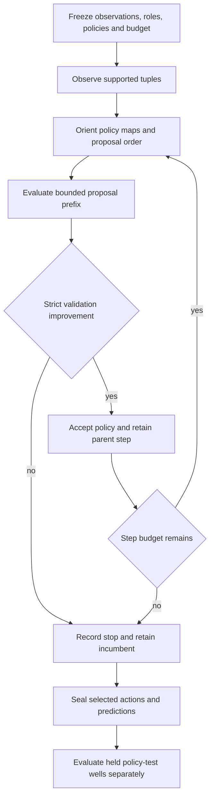

# Policy mapping in the OODA loop

A policy maps an observed condition to an operator or an OFF action. A policy mapper proposes changes to that map. The bounded adapter evaluates those proposals on fixed, permitted evidence, accepts strict objective decreases and records each examined state. This makes the user's higher-policy-to-discrete-action idea executable. [Public adapter](../src/rwt/policy_refinement.py) · [Behavior checks](../tests/test_policy_refinement.py)

Observe retains the original tuple identities and support. Orient constructs the policy neighborhood and proposal order. Decide measures the permitted objective and retains the incumbent unless a proposal improves it. Act installs the accepted policy for the next pass. A Julia sequence can order proposals using observed relationships. The independently measured objective controls acceptance.



## Adapter contract

`refine_policy` takes canonical policy IDs, an evidence digest, a support flag, a proposal callback, a deterministic objective callback and positive step/proposal bounds. The caller binds policy definitions, source identities, roles, station footprint and scoring semantics into the evidence digest. State IDs hash that digest together with the policy ID. The step trace retains the incumbent, examined proposals and accepted successor. Each distinct policy objective is evaluated at most once.

An accepted path strictly decreases the fixed finite objective. It therefore cannot revisit a previously accepted state on that evidence. The maximum number of objective calls is `1 + max_steps * proposal_limit`. The existing bounded worker supplies process time and resource supervision for callback execution. [Execution controller](NODAL_HARNESS.md)

| Stop | Meaning |
| --- | --- |
| `missing_support` | Return OFF without invoking the proposal or objective callback. |
| `stationary` | The examined prefix is empty or contains only the incumbent. |
| `no_improvement` | No examined proposal has a strictly lower objective. |
| `proposal_cycle` | Every examined proposal returns to an accepted ancestor. |
| `step_budget` | The allowed number of rounds has been consumed. The final round may have accepted an improvement. |

The proposal limit counts entries before deduplication. Stopping describes the examined neighborhood under this budget. Global optimality requires separate coverage evidence. Stability of a validation objective requires separate held-well evaluation before asserting predictive merit. The Julia recurrence itself may escape or vary without approaching a fixed point.

This synthetic example resolves one finite neighborhood. Its losses have arbitrary units.

```python
import hashlib
import json
from rwt.policy_refinement import refine_policy

loss = {"base": 4.0, "refined": 3.0}
edges = {"base": ["refined"], "refined": []}
frozen = json.dumps({"loss": loss, "edges": edges}, sort_keys=True).encode()
result = refine_policy(
    "base", off="base",
    evidence_sha256=hashlib.sha256(frozen).hexdigest(), supported=True,
    propose=lambda policy: edges[policy], objective=lambda policy: loss[policy],
    max_steps=3, proposal_limit=2,
)
assert result.policy == "refined" and result.stop_reason == "stationary"
assert result.objective_calls == 2
```

## Field study roles

The first policy study reuses nine original inner models' excluded-well prediction banks. Each bank is divided into five groups. Rotations reserve one group for the new policy test, one for adaptive validation and three for fitting leaf actions. The upstream model excluded the entire bank. The test wells have a history of development reuse. Repeated occurrences are grouped by original well ID when reporting uncertainty. A data custodian routes the archived errors into role packs. Each solver process receives its own fitting and validation errors, with its test errors omitted. The custodian has access to the historical outcome tables.

The fixed action choices are OFF, affine GR and merit-ordered Julia. The initial map splits visible-heel reliability at 0.25. Four predefined refinements use supported section count, merit reordering fraction, expected endpoint knot-shift contrast and opposing endpoint signs. These knot shifts precede the native `q/2` correction gain. A composed Julia descriptor orders proposals using fitting-well observations. A canonical schedule receives the same two-proposal width and three-round cap. An exhaustive-width check tests whether schedule order affects the result when every legal neighbor is examined.

Each leaf applies the existing training-bank support and one-standard-error rule. Children with six to eleven fitting wells retain OFF under its 12-well minimum. The search may accept that fallback if validation improves. Such a change measures a conservative action decision. Predictive admission uses the separately reserved policy-test errors and fixed controls. [Training-bank selector](../src/rwt/operator_selection.py) · [Measurements and admission decisions](MASTER_ITERATION.md)

The completed study failed that predictive gate. Same-member policy-test RMSE was 12.192375 ft with Julia ordering, 12.188605 ft with canonical ordering and 12.174820 ft with the static policy. Julia reduced validation SSE in 17 of 45 searches. The schedules agreed in all 45 exhaustive-width searches. Their finite stopping and validation improvement did not establish a better depth predictor. The public adapter remains a tested search control. [Full outcome and transfer controls](MASTER_ITERATION.md#policy-mapping-inside-a-bounded-ooda-loop)
