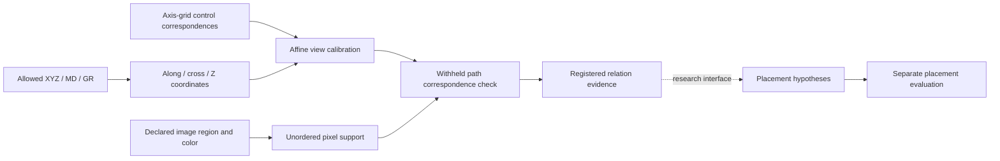

# Registered image relationships

The supplied well figures provide different projections of measured paths, GR traces and labeled geology. Their coordinates can be related explicitly, like registered views on a drafting table. Ingestion preserves the source image and records which region, transform and observations support each numerical relationship.

`rwt.registered_views` rotates XY into along/cross coordinates and retains Z and station identity. Three or more noncollinear world/pixel controls define an invertible affine map. Neither a fixed 45-degree construction nor printed raster units are assumed. A single vertical-plane projection omits perpendicular position; its inverse needs that retained cross coordinate or another independent view.

Color extraction inside a caller-declared ROI produces pixel support, not an inferred station ordering. Legend samples, marker occlusions, other colored curves and regions outside the ROI need explicit accounting. A fitted control-point residual describes the fit to those controls, not independent registration accuracy.

## Checked development-image correspondence

One supplied development figure was calibrated using 42 axis-grid/tick controls, with the blue trajectory and red prediction-start marker withheld from fitting. The declared azimuth was −74.50 degrees. The task and table coordinates are feet; the figure's horizontal “m” label was recorded as inconsistent rather than adopted.

| Check | Result |
| --- | ---: |
| Axis-control fit RMSE | 0.366 pixels |
| Blue-path check | 6,972 stations |
| Median nearest-blue distance | 0.407 pixels |
| 95th percentile distance | 0.646 pixels |
| Stations within 5 pixels | 97.45% |
| Red marker versus projected prediction-start station | 0.471 pixels |

The primary path score retains all stations. The red marker occludes 199 stations and explains the largest distance tail. A separate diagnostic excluding colored overlays retains 6,710 stations, all within 0.704 pixels. The legend's 1,034 blue pixels were excluded from path extraction.

To replay the distance measurement, run `scripts/inspect_registered_views.py` with a control file containing `world` and `pixels` arrays. Add `--check-path-radius-px 5` and an `--exclude-path-roi X0 Y0 X1 Y1` for each legend or annotation to mask. The command saves the distance and original nearest-neighbour index in each direction. The station denominator includes missing projections and stations outside the crop. The reverse denominator counts pixels retained after the declared exclusions.

For the development rendering above, 97.45% of 6,972 stations lie within five pixels of the blue trace. In the reverse direction, 84.29% of the 34,329 retained blue pixels lie within five pixels of a projected station. These are different questions. Line thickness and additional ink affect pixel coverage even when the trajectory follows the line.

This validates registration between the table and its supplied rendering. It does not establish an independent sensor measurement, image-only 3D recovery, or an improvement in TVT prediction. Controls, hashes, arrays and the full local report remain in ignored experiment artifacts.

## Observation boundaries

The supplied PNGs are training-only and contain full-TVT alignment and formation-surface panels. Those panels remain evaluator or supervised-training data, with held-out targets excluded from predictor conditioning. Comparable geometry/GR views can be generated at serving from the same allowed raw observations.

The image inspection CLI reads only MD, X, Y, Z and GR. A source-image hash identifies provenance; it is not a model feature. A finite coordinate resembling a LAS null remains valid unless its source explicitly declares that value missing. Control files must use the same declared coordinate unit as the table.

## Steps, hierarchy and recurrence

Keep three axes distinct when adding operator or Julia-style representations:

- Observation position is keyed by well/station and the measured path index.
- Hierarchy depth describes a lift from measurements to relations or relations between maps.
- Numerical iteration is a step of a chosen recurrence or solver.

An iteration count is not elapsed observation time. A rendering, recurrence descriptor or successful reconstruction identity needs its own matched placement test before entering a predictive claim. The current registered-image code supplies checked ingress; higher-order placement remains a research interface in the master iteration.
